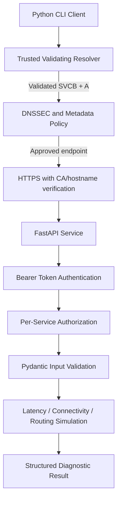
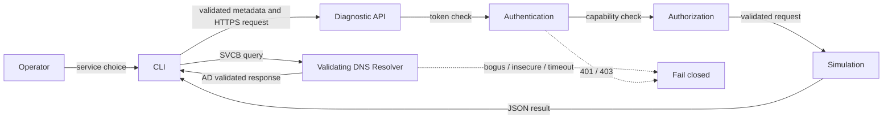

# PS-033 — DNS-Based Discovery of Diagnostic Services

**AIORI-3 Hackathon project report**  
**Report template:** `Proposed-structure-hackathon.pdf` (preserved unchanged)  
**Status:** Implementation and verification report; replace bracketed placeholders with the team's details and live evidence.

## Abstract
PS-033 is a controlled client–server laboratory prototype that discovers diagnostic APIs using DNS SVCB records, requires DNSSEC validation through a trusted recursive resolver, validates endpoint metadata, and invokes protected APIs over HTTPS. Three services are provided: latency probe, connectivity checker, and routing diagnostic. The default diagnostics are deterministic simulations and do not claim to measure or scan real networks.

## Problem Description
- Clients need a discoverable, maintainable way to locate network diagnostic services.
- DNS data can be spoofed or modified unless authenticated and validated.
- Valid discovery alone does not authenticate a service API caller or authorize a diagnostic operation.
- Untrusted metadata can redirect clients to unsafe endpoints.
- Service unavailability and stale DNS cache entries must be handled explicitly.

## Background
DNS maps names to records and can publish service connection parameters. DNSSEC adds origin authentication and integrity to DNS data when a complete chain of trust is validated. HTTPS separately protects application traffic and authenticates the API server. Bearer authentication identifies a client credential, while authorization applies a per-service permission policy. These mechanisms solve different problems and are implemented as distinct gates in PS-033.

## Literature & RFC Review
DNS-AID `draft-mozleywilliams-dnsop-dnsaid-02` is an active Internet-Draft as checked on 13 October 2026, not an RFC. It specifies a DNS-based discovery convention for AI agents using existing DNS record types, including SVCB; it does not define this project's diagnostic API invocation workflow. PS-033 therefore uses SVCB/DNSSEC concepts with an explicit laboratory extension. RFC 9460 defines SVCB/HTTPS records; RFC 4033 introduces DNSSEC; RFC 6763 describes DNS-SD. Full source links and scope notes are in `docs/protocol-review.md`.

## Proposed Solution
The CLI requests a service record from a configured trusted validating resolver. It requires the AD validation signal, parses SVCB metadata, constrains the target to the configured lab zone and service port, resolves the target IP and checks an allow-list. It then invokes the endpoint using certificate-verified HTTPS. The API verifies a bearer token using a configured digest policy, checks per-service authorization, validates request fields, and returns a structured simulated result.

## Solution Optimization

| Concern | Basic approach | PS-033 approach |
|---|---|---|
| Service location | Hard-coded endpoint | DNS SVCB discovery |
| DNS authenticity | Trust response by default | Require trusted resolver validation signal |
| Endpoint safety | Use DNS metadata directly | Validate zone, port, ALPN, and resolved IP allow-list |
| API protection | Public diagnostic route | HTTPS plus bearer authentication and server-side authorization |
| Network impact | Potential arbitrary target | Default simulation and explicit target allow-list |
| Errors | Generic/unstructured | Typed discovery errors and consistent API error envelopes |

## Architecture Design (UML Diagram)

**Figure 1:** PS-033 system architecture. Render this diagram and insert a screenshot for the final presentation if required.

## Data Flow Diagram

**Figure 2:** Data flow and rejection paths.

## Deployment Timeline
1. Phase 1 — requirements, configuration, and project skeleton.
2. Phase 2 — BIND zone, signing, trust-anchor setup, and resolver validation.
3. Phase 3 — the three FastAPI diagnostic routes.
4. Phase 4 — CLI discovery and invocation.
5. Phase 5 — endpoint restrictions, TLS, authentication, and authorization.
6. Phase 6 — unit, integration, and negative security tests.
7. Phase 7 — local and two-machine integration, endpoint-update demonstration.
8. Phase 8 — evidence capture, report review, and presentation.

## Test Methodology and Actual Results
Automated tests are provided under `tests/unit`, `tests/integration`, and `tests/security`. Run `./scripts/run_tests.sh` to generate a JUnit report. **Executed in this workspace:** `python -m pytest -q --junitxml=reports/test-results.xml` completed with **16 passed, 0 failed** in 0.47 seconds on Python 3.13.5. `python -m compileall -q src tests` completed successfully. DNSSEC integration evidence additionally requires BIND/Unbound and locally generated keys; those live-network checks were not executed in this workspace.

| Acceptance check | Evidence status |
|---|---|
| Unit and API security tests | Run locally; attach actual output |
| Signed-zone validation | Requires generated zone and configured trust anchor |
| Bogus signature rejection | Requires controlled negative DNSSEC test |
| Endpoint update and TTL behavior | Requires live DNS lab |
| HTTPS certificate verification | Requires generated CA/server certificate and live client invocation |

## Screenshots and Evidence
- `[Screenshot 1: successful DNSSEC discovery output]`
- `[Screenshot 2: authenticated simulated latency response]`
- `[Screenshot 3: HTTP 401 and HTTP 403 rejection]`
- `[Screenshot 4: bogus DNSSEC validation failure]`
- `[Screenshot 5: controlled endpoint update]`

These are placeholders, not captured screenshots.

## Limitations and Future Improvements
The default diagnostics are simulated. DNSSEC trust depends on the configured resolver and trust-anchor deployment. DNSSEC does not replace TLS, authentication, authorization, or health checks. The current prototype supports a controlled lab domain and allow-listed addresses; it is not a production registry. Future work may add richer telemetry, a persistent audit store, key rotation automation, service health monitoring, and standards-track interoperability testing.

## Conclusion
PS-033 demonstrates a layered approach to DNS-based discovery and protected diagnostic API invocation. The design fails closed when the configured resolver does not provide the required validation signal, constrains endpoint metadata, and keeps discovery separate from service authentication and authorization. Claims of full operational completion should be made only after the live DNSSEC, TLS, and integration demonstrations have been executed and evidenced.

## Bibliography
1. Mozley et al., “DNS for AI Discovery,” Internet-Draft `draft-mozleywilliams-dnsop-dnsaid-02`, May 2026. https://datatracker.ietf.org/doc/html/draft-mozleywilliams-dnsop-dnsaid-02
2. RFC 9460, “Service Binding and Parameter Specification via the DNS (SVCB and HTTPS).” https://www.rfc-editor.org/rfc/rfc9460
3. RFC 4033, “DNS Security Introduction and Requirements.” https://www.rfc-editor.org/rfc/rfc4033
4. RFC 6763, “DNS-Based Service Discovery.” https://www.rfc-editor.org/rfc/rfc6763
